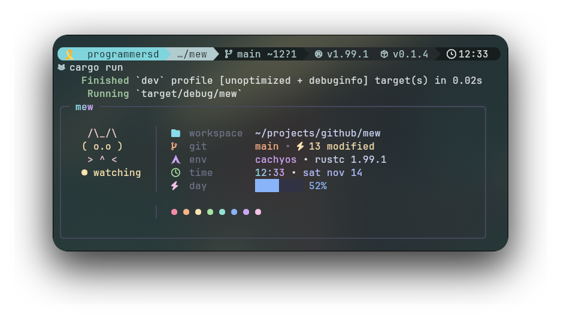

<div align="center">

# mew



**a fast terminal card for your project and its git state.**

[](https://github.com/programmersd21/mew/actions)
[](https://github.com/programmersd21/mew/releases)
[](https://crates.io/crates/mew-cli)
[](https://aur.archlinux.org/packages/mew-bin)
[](LICENSE)
[](https://github.com/programmersd21/mew)

</div>

## what is this

mew prints a small card when you land in a project: where you are, what
git thinks of that, and which toolchain owns the room. it replaces the
`git status` → squint → tab → `git diff` dance with one quiet glance.

no daemon, no polling, no background anything. it reads git state when
you ask and exits.

```text
╭─ mew ────────────────────────────────────────────────────────────────╮
│                                                                      │
│    /\_/\      │    workspace  ~/projects/github/mew                 │
│   ( o.o )     │    git        main •  18 modified                  │
│    > ^ <      │    env        cachyos • rustc 1.99.1                │
│   ● watching  │    time       12:40 • sat nov 14                    │
│               │    day        ████████ 52%                          │
│                                                                      │
│               │  ● ● ● ● ● ● ● ●                                     │
│                                                                      │
╰──────────────────────────────────────────────────────────────────────╯
```

- git branch, dirty/staged/conflict state, ahead/behind your upstream
- project language and live toolchain version (probed, never guessed)
- clock, date, timezone, and how much of the day is gone
- outside a repo, the card doubles as a small uptime + env readout
- themable down to the dot. `NO_COLOR` strips it all

## quick start

```sh
curl -sSf https://raw.githubusercontent.com/programmersd21/mew/main/scripts/install.sh | bash
mew
```

that's it. the installer provisions a starter `theme.toml` for you;
macos and windows work the same way, see below.

<details>
<summary>other ways to install</summary>

```sh
# cargo
cargo install mew-cli

# arch (aur)
paru -S mew-bin

# nix / home-manager: add github:programmersd21/mew as a flake input, then
programs.mew.enable = true;

# from source (rust 1.95+)
git clone https://github.com/programmersd21/mew && cd mew && cargo install --path .
```

windows (powershell):

```powershell
irm https://raw.githubusercontent.com/programmersd21/mew/main/scripts/install.ps1 | iex
```

</details>

## usage

```sh
mew
```

the shell hook re-prints the card on every `cd`, git worktrees only:

```sh
eval "$(mew hook bash)"   # bash
eval "$(mew hook zsh)"    # zsh
mew hook fish | source    # fish
mew hook nu               # nushell
```

```powershell
mew hook powershell | Out-String | Invoke-Expression
```

help, version and error output wear the same palette as the card. piped output and `NO_COLOR` sessions stay plain, exit codes unchanged.

## theming

```sh
mkdir -p ~/.config/mew
mew theme > ~/.config/mew/theme.toml
```

`mew theme` prints the complete annotated template, generated from the
same defaults the binary ships with, so it cannot drift from what the
code actually does. on a tty it prints a syntax highlighted preview
instead. edit anything, delete everything you don't care about.
missing keys fall back to the built-in catppuccin mocha palette.

config path: `~/.config/mew/theme.toml` (linux/macos), `%APPDATA%\mew\theme.toml` (windows).

```toml
[colors]
primary   = "#cdd6f4"   # row values
gauge_fill = "#89b4fa"  # meter fill
dots      = ["#f38ba8", "#fab387", "#f9e2af", "#a6e3a1", "#94e2d5", "#89b4fa", "#cba6f7", "#f5c2e7"]
```

can't parse your theme.toml? you get one warning on stderr and the
built-in defaults, never a crash.

## mew vs fastfetch

fastfetch makes your machine look good. mew makes your afternoon look
honest.

|                    | mew | fastfetch |
| ------------------ | --- | --------- |
| git status         | ✓   | —         |
| branch / conflicts | ✓   | —         |
| toolchain          | ✓   | —         |
| uptime             | ✓   | ✓         |
| system info        | os + uptime only | ✓         |
| shell git hooks    | ✓   | —         |
| system-focused     | —   | ✓         |
| custom modules     | —   | ✓         |

## hacking

clone the repo, then:

```sh
cargo fmt --check && cargo clippy --all-targets --locked -- -D warnings && cargo test --locked
```

ci enforces the same three. see [contributing.md](CONTRIBUTING.md) for
the house rules.

## requirements

- linux, macos, or windows
- a nerd font if you want the icons (the card survives without them)
- rust 1.95+ if building from source

[mit](LICENSE)
